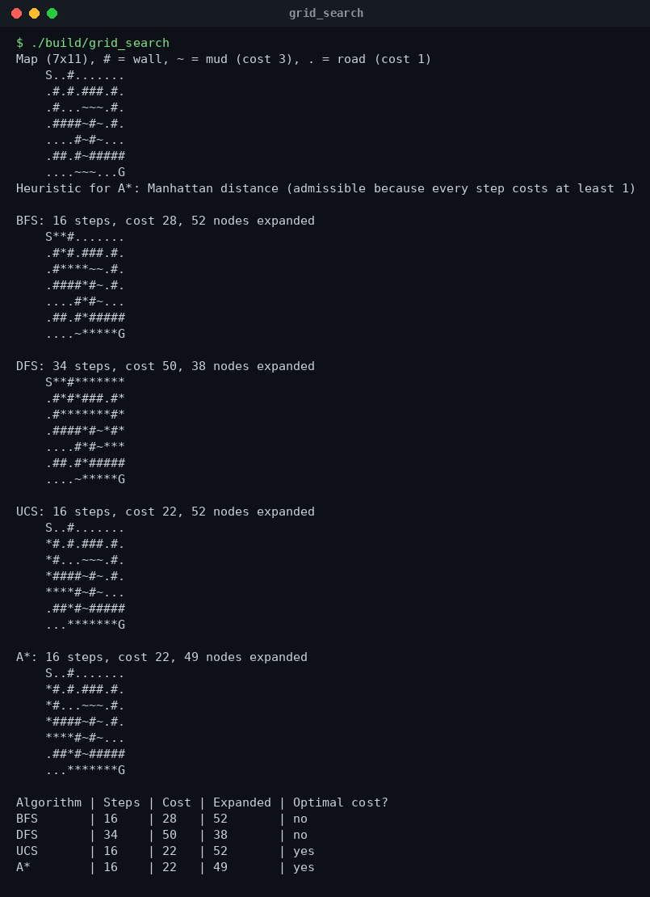
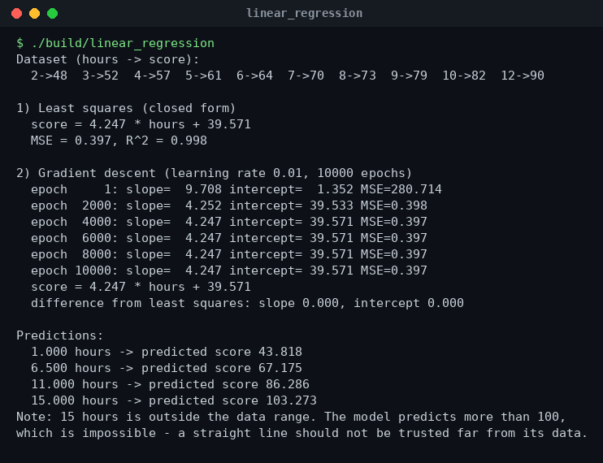
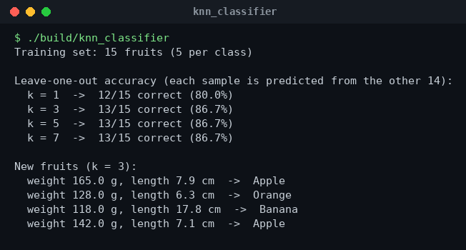

# Artificial Intelligence in C++


Artificial Intelligence (Theory + Lab) practice, written in plain **C++17 with no external libraries**. I implemented the classic search algorithms on a grid map and two basic machine-learning models by hand, so every step (the frontier, the gradient, the vote) is visible in the code.

> My lab-by-lab AI coursework is indexed in [AI-Lab-Projects](https://github.com/dhiaalhaq7979/AI-Lab-Projects).

## Contents

| File | Topic |
|---|---|
| `search/grid_search.cpp` | **BFS, DFS, Uniform Cost Search and A\*** on the same grid map, with the path drawn on the map |
| `machine-learning/linear_regression.cpp` | **Linear regression** — closed-form least squares *and* gradient descent, MSE, R² |
| `machine-learning/knn_classifier.cpp` | **k-Nearest Neighbours** classifier with leave-one-out accuracy for different k |

## Build and run

```bash
make          # compiles everything into ./build
make run      # runs all three programs
```

Or compile one program:

```bash
g++ -std=c++17 -O2 search/grid_search.cpp -o grid_search && ./grid_search
```

## 1. Search on a grid

```
S..#.......     S = start, G = goal
.#.#.###.#.     # = wall
.#...~~~.#.     ~ = mud  (cost 3)
.####~#~.#.     . = road (cost 1)
....#~#~...
.##.#~#####
....~~~...G
```

| Algorithm | Steps | Path cost | Nodes expanded | Optimal cost? |
|-----------|-------|-----------|----------------|---------------|
| BFS | 16 | 28 | 52 | no |
| DFS | 34 | 50 | 38 | no |
| UCS | 16 | **22** | 52 | yes |
| A\* (Manhattan) | 16 | **22** | **49** | yes |

- **BFS** finds the fewest steps but walks straight through the mud.
- **DFS** finds *a* path quickly, but a long and expensive one.
- **UCS** and **A\*** both find the cheapest path; A\* expands fewer nodes because the Manhattan heuristic guides it toward the goal (it is admissible because every step costs at least 1).



## 2. Linear regression (by hand)

Small practice dataset: hours studied per week → exam score.

- **Least squares:** `score = 4.247 × hours + 39.571`, MSE = 0.397, R² = 0.998
- **Gradient descent** (learning rate 0.01, 10,000 epochs) converges to the same line.
- The program also shows why extrapolation is dangerous: 15 hours "predicts" a score above 100.



## 3. k-Nearest Neighbours (by hand)

Classifies fruit (apple / orange / banana) from weight and length, using Euclidean distance with scaled features.

| k | Leave-one-out accuracy |
|---|---|
| 1 | 80.0 % |
| 3 | 86.7 % |
| 5 | 86.7 % |
| 7 | 86.7 % |



## What I learned

- How the frontier data structure (queue, stack, priority queue) decides the behaviour of a search
- Why a good heuristic saves work without losing optimality
- How gradient descent slowly reaches the same answer as the closed-form formula
- That k-NN needs feature scaling, and how the choice of k changes accuracy

## Author

**Dheya Alhag** — BS Software Engineering, Superior University, Lahore
GitHub: [@dhiaalhaq7979](https://github.com/dhiaalhaq7979)
